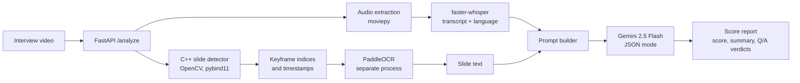

# AI Interview Judge

[](https://github.com/bigalex95/ai-interview-judge/actions/workflows/ci.yml)


[](LICENSE)

Prototype that grades a recorded technical interview: a C++/OpenCV detector finds the moments when the on-screen slide changes, OCR reads those slides, Whisper transcribes the speech, and Gemini scores the candidate's answers against the slide content. Exposed as a FastAPI service with a small Streamlit UI.

<!-- TODO: demo GIF (upload a video in the Streamlit UI, show the returned score + Q/A verdicts) -->

## Highlights

- **Slide-change detector in C++17 / OpenCV** (`cpp_core/`): grayscale, Gaussian blur, Canny edges, dilation, then the changed area of the edge map is compared with the *last accepted slide* (not the previous frame). That keeps slow drift and a moving speaker from triggering detections. Exposed to Python through pybind11 as `ai_interview_cpp`.
- **Unit-tested and benchmarked core**: GoogleTest suite on synthetic videos, run in CI; a small throughput benchmark is included (see [Results](#results)).
- **Multimodal pipeline**: `faster-whisper` ASR (with language auto-detection), PaddleOCR on the detected slides (language chosen from the detected speech language), Gemini for evaluation.
- **FastAPI backend + Streamlit frontend**, with CPU and GPU Dockerfiles and a compose file.

## Architecture



Notes:

- The detector returns frame indices and timestamps; the OCR worker re-reads those frames from the video. The first frame always counts as a slide.
- PaddleOCR runs in a spawned subprocess because Torch/Paddle OpenMP libraries conflict when loaded in the same process.
- ASR, detection and OCR failures are logged and the pipeline continues with whatever data is available; if neither transcript nor slide text exists, no LLM call is made.

## Tech stack

C++17, OpenCV (tested with 4.5.4), pybind11, CMake, GoogleTest; Python 3.10+, FastAPI, faster-whisper, PaddleOCR, moviepy, `google-generativeai` (Gemini), Streamlit, uv, Docker.

## Getting started

### Docker Compose (CPU)

```bash
cp .env.example .env        # then set GEMINI_API_KEY
docker compose up -d --build ai-judge-cpu frontend
```

- API: http://localhost:8000 (interactive docs at `/docs`)
- Streamlit UI: http://localhost:8501

GPU variant (needs NVIDIA Container Toolkit); name the services explicitly so the CPU ones are not started too (both sets use ports 8000/8501):

```bash
docker compose --profile gpu up -d --build ai-judge-gpu frontend-gpu
```

### Local build

Prerequisites: CMake >= 3.14, a C++17 compiler, OpenCV dev package (`libopencv-dev`), Python dev headers, [uv](https://docs.astral.sh/uv/), ffmpeg (for audio extraction). pybind11 is fetched by CMake.

```bash
# 1. Build the C++ extension (writes libs/ai_interview_cpp*.so)
./scripts/build.sh              # or: cmake -S . -B build && cmake --build build -j

# 2. Install Python dependencies and run the API
uv sync
uv run uvicorn backend.main:app --port 8000
```

## API usage

| Method | Path       | Description                                                                 |
| ------ | ---------- | --------------------------------------------------------------------------- |
| GET    | `/`        | Service info and whether the ML models loaded                               |
| GET    | `/health`  | `healthy`, or `degraded` if the models failed to initialise                 |
| POST   | `/analyze` | Multipart upload (`file`), runs the full pipeline synchronously, returns JSON |

```bash
curl -X POST http://localhost:8000/analyze -F "file=@interview.mp4"
```

Response shape (values elided):

```json
{
  "meta": { "video_path": "...", "status": "completed", "detected_language": "en" },
  "transcription": [ { "start": 0.0, "end": 4.2, "text": "..." } ],
  "visual_context": [ { "timestamp": 12.4, "frame_index": 372, "ocr_text": "..." } ],
  "ai_evaluation": {
    "interview_score": 0,
    "summary": "...",
    "qa_pairs": [
      {
        "question_topic": "...",
        "slide_text_snippet": "...",
        "candidate_answer_summary": "...",
        "verdict": "Correct | Partial | Wrong | Unknown",
        "explanation": "..."
      }
    ]
  }
}
```

`interview_score` is an integer from 1 to 10 requested in the prompt. Without `GEMINI_API_KEY`, `ai_evaluation` is `{"error": "..."}`.

## Configuration

Environment variables (see `.env.example`; names only):

- `GEMINI_API_KEY` - required for the LLM scoring step
- `DEBUG`, `LOG_LEVEL`
- `MIN_SCENE_DURATION`, `MIN_AREA_RATIO` - slide detector defaults in `backend/core/config.py`
- `API_HOST`, `API_PORT`, `API_WORKERS`
- `API_URL` - used by the Streamlit frontend to find the backend

Known gap: `AnalysisService` currently constructs the detector with fixed values (2.0 s, 0.15) and does not read `MIN_SCENE_DURATION` / `MIN_AREA_RATIO`. Detector parameters:

- `min_scene_duration_sec` - minimum time between two detected slides (debounce)
- `min_area_ratio` - fraction of the frame whose edge map must change to count as a new slide

## Tests and CI

```bash
# C++ unit tests (GoogleTest, fetched by CMake)
cmake -S . -B build -DBUILD_TESTS=ON
cmake --build build -j
ctest --test-dir build --output-on-failure

# Python tests (language-code mapping, OCR worker signature)
uv sync && uv run pytest tests/python
# CI installs only the imported packages instead; see .github/workflows/ci.yml
```

The C++ suite renders short synthetic "presentations" to lossless video files and checks: identical frames yield one segment, a slide change is detected at the right frame, A-B-A switches give three segments, `min_scene_duration` delays detection, a ~1% change is ignored at the default threshold but detected at a lower one, thresholds of 0 and 1, 1080p input (downscale path), `get_frame`, and error handling for missing files.

GitHub Actions (`.github/workflows/ci.yml`) builds the C++ code and runs `ctest`, and runs the Python tests with a reduced dependency set (no PaddleOCR/Torch). CI does not run the full ASR/OCR/Gemini pipeline or build the Docker images.

## Results

Slide detector throughput on synthetic video (lossless FFV1/AVI, slide change every 60 frames, small moving box), median of 5 runs after one warm-up, single process, CPU only; the table shows the median over 3 invocations with the min-max range in parentheses:

| Resolution | Decode only (frames/s) | `process_video` (frames/s) |
| ---------- | ---------------------- | -------------------------- |
| 1280x720   | 904 (902-924)          | 502 (502-507)              |
| 1920x1080  | 427 (426-427)          | 277 (274-279)              |

Hardware: AMD Ryzen 7 5800H (16 threads), g++ 13.4, OpenCV 4.5.4, Release build. Throughput varies with system load: earlier runs on the same machine under load gave roughly 350 fps (720p) and 265 fps (1080p) for `process_video`. Frames wider than 1280 px are downscaled to 1280 px before edge detection. Synthetic lossless video decodes faster than typical H.264 recordings, so real-file throughput will be lower. This measures speed only; there is no accuracy evaluation on real interview recordings yet.

Reproduce:

```bash
cmake -S . -B build -DBUILD_BENCHMARKS=ON
cmake --build build --target bench_slide_detector -j
./build/benchmarks/bench_slide_detector 1280 720 300 5   # width height frames runs
```

## Project structure

```
cpp_core/            C++ slide detector (static lib) + pybind11 bindings
benchmarks/          Slide detector throughput benchmark
backend/             FastAPI app, config, services (audio, video, OCR, LLM, orchestration)
frontend/            Streamlit UI
tests/cpp/           GoogleTest unit tests
tests/python/        pytest tests
docker/, docker-compose.yml           Container setup
scripts/             Build/run helpers; slide_demo.py is a CLI demo of the detector
docs/                Frontend setup, language detection notes, sharing guide
```

## Limitations and status

- Working prototype, not production software. Analysis is synchronous (one upload blocks until Whisper, OCR and Gemini finish); there is no queue, auth or rate limiting.
- Slide detection is edge-map based and tuned by hand: it is meant for screen-share/slide recordings, can fire on large animations or window switches, and has not been evaluated against labelled data.
- Detector settings in `.env` are not yet wired into the analysis pipeline (see Configuration).
- The LLM verdicts depend on OCR quality and on Gemini; scores are not calibrated or validated against human graders.

## License

MIT, see [LICENSE](LICENSE).
